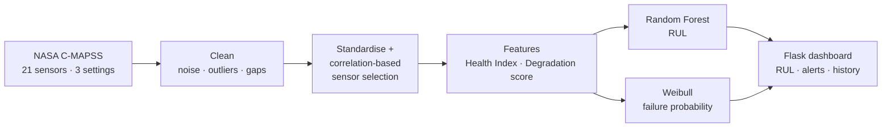

<div align="center">

# ✈️ Predictive Maintenance for Turbofan Jet Engines

**Remaining Useful Life (RUL), Health Index and failure-risk prediction on NASA C-MAPSS sensor data**

*Code for the paper "Enhancing Transport Efficiency through Predictive Maintenance: A Machine Learning Approach Using NASA Turbofan Jet Engine Dataset".*


</div>

---

## 🎯 What it does

Instead of servicing engines on a fixed calendar, this project predicts **how many cycles an engine has left** so maintenance happens just in time, with less downtime and lower cost.

| Signal | How it's computed | Used for |
|---|---|---|
| **RUL** | `RUL = T_max − T_current` as the training target; predicted by a Random Forest | Scheduling maintenance |
| **Health Index** | `HI = 1 − sensor deviation / max deviation` (1 = healthy, 0 = failure) | HI **below 0.4 = high risk** |
| **Degradation score** | Weighted sum of normalised sensor readings | Tracking cumulative wear |
| **Threshold alerts** | Flag when a key sensor crosses its limit | Catching sudden faults |
| **Weibull analysis** | `F(t) = 1 − e^-(t/η)^β` | Failure probability over time (reliability falls from 90% to 50% within the first ~100 of 300 cycles) |

## 🔬 Pipeline



Exploration in the notebook covers PCA scatter plots, a 3D sensor surface plot, a sensor-correlation heatmap and a per-unit sensor heatmap.

## 📁 Repository

| Path | What it is |
|---|---|
| `NASA_TURBOFAN.ipynb` / `nasa_turbofan.py` | EDA, feature engineering, model training |
| `random_forest_model.pkl` | Trained RUL model |
| `app.py` | Flask app: `/` and `POST /analyze` |
| `templates/`, `static/` | Dashboard UI |
| `rul_history.json`, `fault_history.json` | Stored prediction and fault history |
| `archive.zip` | NASA C-MAPSS data |

## 🚀 Run it

```bash
pip install flask pandas scikit-learn joblib
# app.py expects the model at rul_predictor_model.pkl, so rename random_forest_model.pkl or update MODEL_PATH
python app.py
```

Open http://127.0.0.1:5000, enter sensor readings and get the predicted RUL with a risk status.

## 🛣️ Next steps (from the paper)

Deep learning / LLM-assisted models · IoT and edge computing for real-time data · AR/VR diagnostic dashboards · securing sensor data.

## 👥 Authors

Ansh Soni, **Krish Modi**, Aneri Shah, Nishant Doshi
Department of Computer Science & Engineering, School of Technology, Pandit Deendayal Energy University

<div align="center"><sub>Related work: <a href="https://github.com/krishmodi0202/Transformer-Efficiency">Hybrid AI for transformer power systems</a></sub></div>
